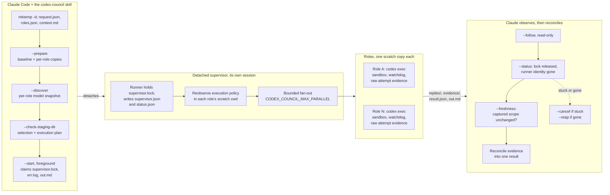
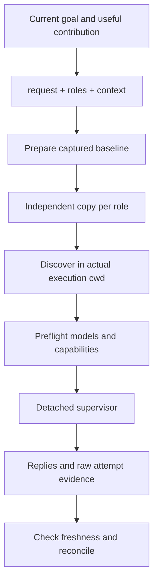
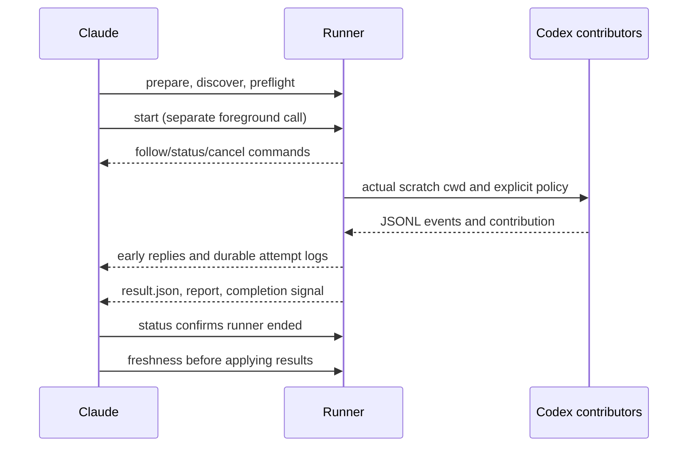
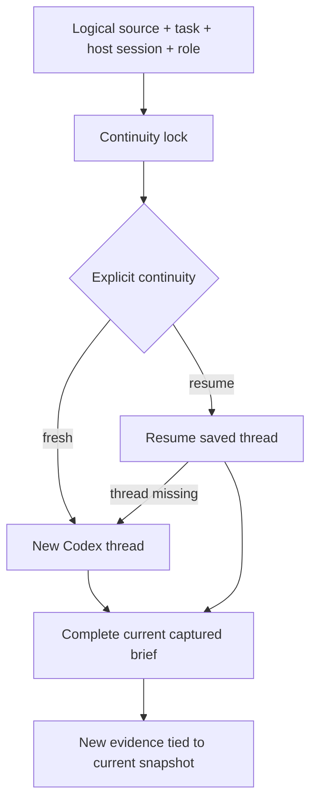

# codex-council

Adaptive, on-demand **OpenAI Codex collaboration for Claude Code**: task-shaped
contributions, captured inputs, disposable experiments, and one reconciled result.
Claude decides when collaboration is useful, supplies current context, and remains
responsible for the outcome. The runner owns execution and evidence, not judgment.

A contribution can investigate, reproduce, test, research, compare alternatives, or
build an authorized candidate. One is often enough. There is no role catalog,
model ranking, fixed panel size, peer-debate loop, or automatic per-turn hook.

## Requirements

| Component | Supported |
|---|---|
| Claude Code | 2.1.x, with plugin skills |
| Codex CLI | codex-cli 0.163 or later, signed in; behavior verified on 0.163.0 |
| Python | 3.12 or later, on macOS or Linux |

The skill speaks contract epoch 5. The runner uses only the standard library and
POSIX process controls. Missing policy metadata blocks restricted execution rather
than granting bypass. Neither native user configuration nor the host Claude
model/effort is edited. The fake-Codex test suite makes no claim about real-model
quality or real-host sandbox enforcement; [Testing](#testing) describes the
opt-in signed-in host checks. See [DESIGN.md](DESIGN.md) for the mechanism.

## Install and invoke

```zsh
claude plugins marketplace add ehzawad/codex-council
claude plugins install codex-council@codex-council
```

Invoke `/codex-council:codex-council`, ask “codex council,” or let Claude choose it
when an independent contribution could materially improve the next decision.
A new turn alone is not a reason to invoke. Requests for Claude's own subagents
remain a separate workflow; genuinely unresolved intent gets a brief clarification.

For the turn that invokes it, the skill pre-approves `mktemp -d` and the runner
commands exactly as SKILL.md writes them. That pre-approval does not carry into
later turns, so SKILL.md tells Claude to invoke the skill again before a follow-up
`--status`, `--freshness` or `--cancel` and before every new council. Claude Code
asks before Claude itself invokes a skill that pre-approves tools, so in a `dontAsk`
or other unattended session invoke `/codex-council:codex-council` directly or allow
`Skill(codex-council:codex-council)`. Such a session also needs, in its session or
project settings, Write permission for the run directory (it is outside the project;
a Write rule for the temporary directory is enough) and an allow rule for the runner
command pattern. The skill does not pre-approve Write.

The main skill is deliberately small. It reads focused references when needed,
not all documentation on every invocation. Tests and project documentation are
outside the installed plugin source (`plugins/codex-council`).

## Architecture



## One invocation



Claude stages a fresh, decision-complete brief whenever Council is useful, whether
that is one or ten turns after the last run. A stable task id and logical project
identity are separate from the captured input hash and optional Codex thread.
Previous conclusions are context, not automatically current evidence.

Preparation captures **working bytes**, not just Git HEAD: dirty tracked files,
staged/unstaged edits, deletions, and non-ignored untracked files. A partially staged
file is captured as its working version, not its staged version. Non-Git capture
uses explicit include paths and keeps empty directories; a context-only question
may select no files. Pause
overlapping writers during capture. The runner detects observed changes but does
not claim an atomic snapshot of arbitrary external writers.

Every contribution receives an independent copy of the same baseline. Claude may
continue independent work afterward. Copying avoids shared Git control metadata,
unsafe hardlinks, and the incompatibility between Codex worktree and resume modes.
It also means Git-dependent build commands can need additional setup; a missing
environment prerequisite is a coverage gap, not evidence of a source bug.

## Input and execution contracts

See [invocation-contract.md](plugins/codex-council/skills/codex-council/references/invocation-contract.md)
for complete JSON examples and fields. Permissions are separate from role labels:

| Capability | Default | Scope |
|---|---|---|
| Command sandbox | read-only | Choose workspace-write for scratch experiments; bypass requires explicit authorization. |
| Command network | false | Explicitly authorize when necessary. Bypass cannot enforce network denial. |
| External tools | deny | Apps/plugins/browser/computer/hooks/subagents/web, notify, installer/remote-plugin features and configured MCP servers disabled; native integrations require authorization. |
| Thread continuity | fresh | Explicit resume within logical project, task, host session and role. |
| Required contribution | true | Missing execution/evidence leaves required coverage incomplete. |

Preflight shows role count, model/effort plan, context bytes, watchdog, scratch
scope, capabilities and continuity. Metadata is rechecked before inference.
Configuration evidence is not an attestation of a later process: managed settings,
unsupported fields or an unknown tool inventory fail closed. No silent bypass or
model hopping is used as recovery.

Source agent configuration directories (`.codex`, `.claude`, `.agents`), agent
instruction files (AGENTS.md, AGENTS.override.md, CLAUDE.md, CLAUDE.local.md),
credentials and caches are not copied; put any project rule a role needs in the brief. Native model
inheritance means what Codex resolves in the **scratch execution cwd**, not a
promise to preserve source-project `.codex/config.toml` settings. Inspect discovery
and pin supported values explicitly when that distinction matters. Model choices
remain runtime-grounded; every role has its own catalog snapshot. Reports state
what was sent, not which model served a turn.

## Lifecycle and evidence



The detached supervisor relies on private-directory gates, a lock token, process
identities, liveness ticks, bounded concurrency and conservative cleanup.
`preparing` means bounded metadata work, not worker dispatch. `--follow` is read-only.
The final line alone does not prove completion: `--status` requires released lock
and vanished recorded identity. `--cancel` stops a verified detached runner;
`--reap` cleans verified recorded workers only after the runner is gone.

| Output | Meaning |
|---|---|
| run.json / baseline / workspaces | Invocation identity, exact captured inputs and independent experimental copies. |
| catalogs/ | Model/configuration discovery in each actual execution cwd. |
| evidence/ | Private raw stdout/stderr, attempt metadata, policy observations and candidate artifacts. |
| result.json | Versioned observations, completeness and applicability, separate from collaborator interpretation. |
| replies/ / out.md | Early role replies and the readable final report. |

Command fields in JSONL are Codex-reported observations, not an independent OS audit.
The runner never infers substantive correctness from a clean exit or agreement.
Text changes may have a candidate diff; exact binary/large/mode-only changes stay
in scratch with artifact metadata. **Nothing automatically applies, commits, or
publishes a candidate change to the live source.** Claude checks current intent,
freshness, evidence and integration results before accepting it.

Exit 0 requires delivered output and complete required contributions; exit 1
includes required-coverage/evidence failure, and exit 2 is invalid input or refused
policy. `--freshness` exits 0 unchanged, 1 stale/unknown, 2 invalid contract.
Workers start only from `--start` on a completed capture, once per run directory;
there is no direct launch.

## Continuity and failures



Saved threads are scoped by `CODEX_COUNCIL_SESSION_KEY`, then detected host ids,
then project scope. `CODEX_COUNCIL_SESSION_KEY` is the reliable scope: a detected
`CLAUDE_CODE_SESSION_ID` can keep the startup id after `--resume` or `--continue`,
and integrated terminals in the same VS Code window share `VSCODE_PID`. Thread state does
not save a model or effort, and a resumed history does not establish current facts.
Saved state has no automatic expiry; do not delete lock files while runs use them.

A transient 429/5xx is retried only before side-effect-capable work, using the same
scanner as watchdog stalls, and only for a read-only role with external tools denied:
the exec JSONL omits some tool calls, so a writable role is never replayed. Once tool work or unreadable output may have occurred,
`replay-blocked:*` requires deliberate recovery. Quota, authentication and model
rejection remain terminal; valid continuity is not discarded on those failures.

Settings: `CODEX_COUNCIL_MAX_PARALLEL` defaults to 6,
`CODEX_COUNCIL_STALL_SECS` to 1800 (0 disables), model routing to auto (off disables
automatic choices), and state under `$XDG_STATE_HOME/codex-council` or
`~/.local/state/codex-council`. There is no run-level deadline. Detached work keeps
running and spending until completion/cancellation; do not abandon observation.
See [runtime recovery](plugins/codex-council/skills/codex-council/references/runtime-behavior.md).

## Security and known limits

Scratch separation is not a whole-process security boundary. Codex command sandbox
modes do not promise to hide HOME or constrain every external integration. An
orchestrator-written authorization string is a declaration, not independently
authenticated user consent. Same-user/bypass processes can tamper with files;
checksums and read-only modes detect mistakes, not all malicious activity. Use
trusted inputs and verify actual sandbox denials on the target host.

Excluded data, dependency state, Git metadata, ACLs/xattrs and remote services are
not recreated. Freshness only covers the selected filesystem state; changed user
intent must be checked by Claude. Raw logs may hold sensitive tool output. Keep
them private. The exec reader holds each attempt's protocol output in memory, so
runner RAM is not bounded for arbitrarily chatty workers.

## Testing

From the repository root, with Python 3.12 or later:

```zsh
env -u CODEX_COUNCIL_LIVE_TESTS -u CODEX_COUNCIL_LIVE_WORKFLOW \
  python3 -m unittest discover -s tests -p 'test_*.py' -v
uvx --from 'ruff==0.15.21' ruff check .
claude plugin validate plugins/codex-council
claude plugin validate .
```

The offline suite runs unit, fake-Codex protocol, CLI and real-process liveness
tests; it uses no Codex account and no inference. CI runs it on Ubuntu (Python
3.12 to 3.15) and macOS (3.13), plus the same Ruff check.

Two opt-in gates use the installed `codex`, the signed-in account and real usage.
Run them only after the offline checks pass; each needs its variable set to `1`:

```zsh
CODEX_COUNCIL_LIVE_TESTS=1 python3 -m unittest tests.test_live_codex -v
CODEX_COUNCIL_LIVE_WORKFLOW=1 python3 -m unittest discover -s tests -p 'test_live_workflow.py' -v
```

`test_live_codex` checks model/effort routing, the `-c` overrides sent and thread
continuity on trivial prompts. `test_live_workflow` checks that workspace-write
allows a scratch write but denies an external write and a command-network
connection, and that read-only denies both writes, using temporary canaries and a
host-local listener. A model that declines the probe is not a pass, and a refused
policy is never a reason to enable bypass. The workflow gate prints the private
evidence directories it keeps; inspect them, then remove them once the runner has
exited. Smoke-test threads stay in Codex history.

For a host smoke check, start one fresh session from this checkout, which changes
nothing installed:

```zsh
claude --plugin-dir ./plugins/codex-council
```

Invoke `/codex-council:codex-council` on a small task, then check the brief,
`--status`, `result.json` and `--freshness` before accepting the result. Record the
commit, OS, Claude Code and Codex versions, and host model/effort. Do not change
global model settings to test the plugin.

## License

[MIT](LICENSE).
