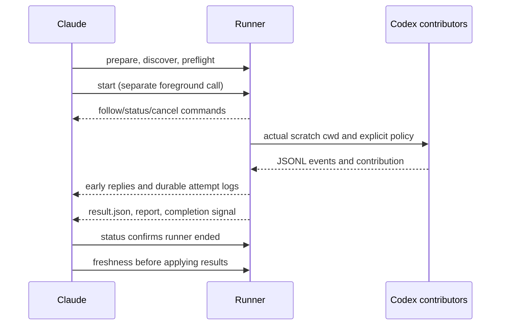
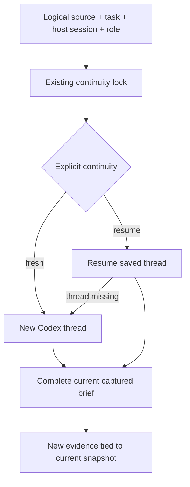

# codex-council

Adaptive, on-demand **OpenAI Codex collaboration for Claude Code**: task-shaped
contributions, captured inputs, disposable experiments, and one reconciled result.
Claude decides when collaboration is useful, supplies current context, and remains
responsible for the outcome. The runner owns execution and evidence, not judgment.

A contribution can investigate, reproduce, test, research, compare alternatives, or
build an authorized candidate. One is often enough. There is no role catalog,
model ranking, fixed panel size, peer-debate loop, or automatic per-turn hook.

## Release candidate

**1.3.0-rc.1, skill contract 5.** This changes permissions and the skill's launch
protocol. Validate on your signed-in macOS/Ubuntu hosts before merging/releasing.
See [local validation](docs/LOCAL_VALIDATION.md) and [changes](CHANGELOG.md).
No claim of real-model quality or real-host sandbox enforcement comes from the
fake-Codex test suite.

Requirements: Claude Code with plugin skills, a signed-in Codex CLI exposing
app-server metadata and the documented sandbox configuration, and Python 3.12+
on macOS or Linux. The runner uses only the standard library and POSIX process
controls. Missing policy metadata blocks restricted execution rather than granting
bypass. Neither native user configuration nor the host Claude model/effort is edited.

## Install and invoke

```zsh
claude plugins marketplace add ehzawad/codex-council
claude plugins install codex-council@codex-council
```

Invoke `/codex-council:codex-council`, ask “codex council,” or let Claude choose it
when an independent contribution could materially improve the next decision.
A new turn alone is not a reason to invoke. Requests for Claude's own subagents
remain a separate workflow; genuinely unresolved intent gets a brief clarification.

The main skill is deliberately small. It reads focused references when needed,
not all documentation on every invocation. Tests, build scripts, and project docs
are outside the installed plugin source (`plugins/codex-council`).

## One invocation


Claude stages a fresh, decision-complete brief whenever Council is useful, whether
that is one or ten turns after the last run. A stable task id and logical project
identity are separate from the captured input hash and optional Codex thread.
Previous conclusions are context, not automatically current evidence.

Preparation captures **working bytes**, not just Git HEAD: dirty tracked files,
staged/unstaged edits, deletions, and non-ignored untracked files. Non-Git capture
uses explicit include paths; a context-only question may select no files. Pause
overlapping writers during capture. The runner detects observed changes but does
not claim an atomic snapshot of arbitrary external writers.

Every contribution receives an independent copy of the same baseline. Claude may
continue independent work afterward. Copying avoids shared Git control metadata,
unsafe hardlinks, and the incompatibility between Codex worktree and resume modes.
It also means Git-dependent build commands can need additional setup; a missing
environment prerequisite is a coverage gap, not evidence of a source bug.

## Input and execution contracts

See [invocation-contract.md](plugins/codex-council/skills/codex-council/references/invocation-contract.md)
for complete JSON examples and fields. Permissions are separate from role labels:

| Capability | Default | Scope |
|---|---|---|
| Command sandbox | read-only | Choose workspace-write for scratch experiments; bypass requires explicit authorization. |
| Command network | false | Explicitly authorize when necessary. Bypass cannot enforce network denial. |
| External tools | deny | Apps/plugins/browser/computer/hooks/subagents/web and configured MCP servers disabled; native integrations require authorization. |
| Thread continuity | fresh | Explicit resume within logical project, task, host session and role. |
| Required contribution | true | Missing execution/evidence leaves required coverage incomplete. |

Preflight shows role count, model/effort plan, context bytes, watchdog, scratch
scope, capabilities and continuity. Metadata is rechecked before inference.
Configuration evidence is not an attestation of a later process: managed settings,
unsupported fields or an unknown tool inventory fail closed. No silent bypass or
model hopping is used as recovery.

Source agent configuration, credentials and caches are not copied. Native model
inheritance means what Codex resolves in the **scratch execution cwd**, not a
promise to preserve source-project `.codex/config.toml` settings. Inspect discovery
and pin supported values explicitly when that distinction matters. Model choices
remain runtime-grounded; every role has its own catalog snapshot. Reports state
what was sent, not which model served a turn.

## Lifecycle and evidence



The existing detached supervisor, private-directory gates, lock token, process
identities, liveness ticks, bounded concurrency and conservative cleanup remain.
`preparing` means bounded metadata work, not worker dispatch. `--follow` is read-only.
The final line alone does not prove completion: `--status` requires released lock
and vanished recorded identity. `--cancel` stops a verified detached runner;
`--reap` cleans verified recorded workers only after the runner is gone.

| Output | Meaning |
|---|---|
| run.json / baseline / workspaces | Invocation identity, exact captured inputs and independent experimental copies. |
| catalogs/ | Model/configuration discovery in each actual execution cwd. |
| evidence/ | Private raw stdout/stderr, attempt metadata, policy observations and candidate artifacts. |
| result.json | Versioned observations, completeness and applicability, separate from collaborator interpretation. |
| replies/ / out.md | Early role replies and the readable final report. |

Command fields in JSONL are Codex-reported observations, not an independent OS audit.
The runner never infers substantive correctness from a clean exit or agreement.
Text changes may have a candidate diff; exact binary/large/mode-only changes stay
in scratch with artifact metadata. **Nothing automatically applies, commits, or
publishes a candidate change to the live source.** Claude checks current intent,
freshness, evidence and integration results before accepting it.

Prepared exit 0 requires delivered output and complete required contributions;
exit 1 includes required-coverage/evidence failure, and exit 2 is invalid input or
refused policy. `--freshness` exits 0 unchanged, 1 stale/unknown, 2 invalid contract.
Legacy direct CLI without preparation remains read-only and keeps “some role
responded” exit semantics, without the captured-evidence guarantees.

## Continuity and failures



Saved threads are scoped by `CODEX_COUNCIL_SESSION_KEY`, then detected host ids,
then project scope. Integrated terminals in the same VS Code window share
`VSCODE_PID`; set `CODEX_COUNCIL_SESSION_KEY` to separate them. Thread state does
not save a model or effort, and a resumed history does not establish current facts.
Saved state has no automatic expiry; do not delete lock files while runs use them.

A transient 429/5xx is retried only before side-effect-capable work, using the same
scanner as watchdog stalls. Once tool work or unreadable output may have occurred,
`replay-blocked:*` requires deliberate recovery. Quota, authentication and model
rejection remain terminal; valid continuity is not discarded on those failures.

Settings retained: `CODEX_COUNCIL_MAX_PARALLEL` defaults to 6,
`CODEX_COUNCIL_STALL_SECS` to 1800 (0 disables), model routing to auto (off disables
automatic choices), and state under `$XDG_STATE_HOME/codex-council` or
`~/.local/state/codex-council`. There is no run-level deadline. Detached work keeps
running and spending until completion/cancellation; do not abandon observation.
See [runtime recovery](plugins/codex-council/skills/codex-council/references/runtime-behavior.md).

## Security and known limits

Scratch separation is not a whole-process security boundary. Codex command sandbox
modes do not promise to hide HOME or constrain every external integration. An
orchestrator-written authorization string is a declaration, not independently
authenticated user consent. Same-user/bypass processes can tamper with files;
checksums and read-only modes detect mistakes, not all malicious activity. Use
trusted inputs and verify actual sandbox denials on the target host.

Excluded data, dependency state, Git metadata, ACLs/xattrs and remote services are
not recreated. Freshness only covers the selected filesystem state; changed user
intent must be checked by Claude. Raw logs may hold sensitive tool output. Keep
them private. The existing exec reader still retains protocol output in memory;
this release does not claim fully bounded RAM for arbitrarily chatty workers.

## Development

```zsh
python3 -m unittest discover -s tests -p 'test_*.py' -v
uvx --from 'ruff==0.15.21' ruff check .
```

CI runs the full fake/protocol/process suite on Ubuntu and macOS. No real model
credentials or inference are used by default. Opt-in real-host checks and a
copy-pastable validation prompt are in [LOCAL_VALIDATION.md](docs/LOCAL_VALIDATION.md).
Existing module-DAG tests include the new workspace, policy, evidence and workflow
modules. Documentation tests check parseable commands, JSON shapes and packaging,
not hundreds of exact prose phrases.

`./scripts/dev-link.sh` remains the development-link helper. Alternatively load
this checkout with Claude Code's `--plugin-dir ./plugins/codex-council` option in a
fresh session. Do not modify global model settings to test the plugin.

`scripts/build-docs.sh` can generate a PDF locally. Generated PDFs are not committed;
Markdown is authoritative and release builds may attach generated documentation.

## License

[MIT](LICENSE).
